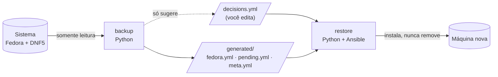
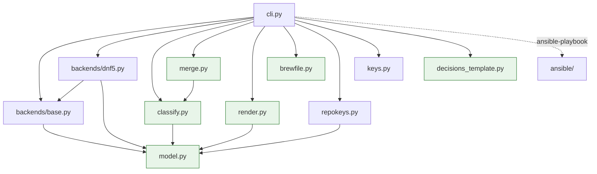
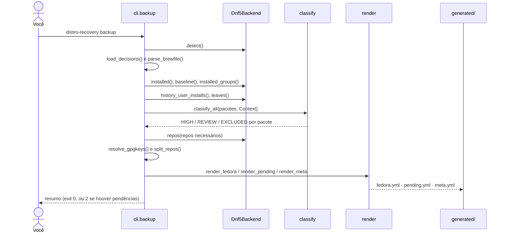
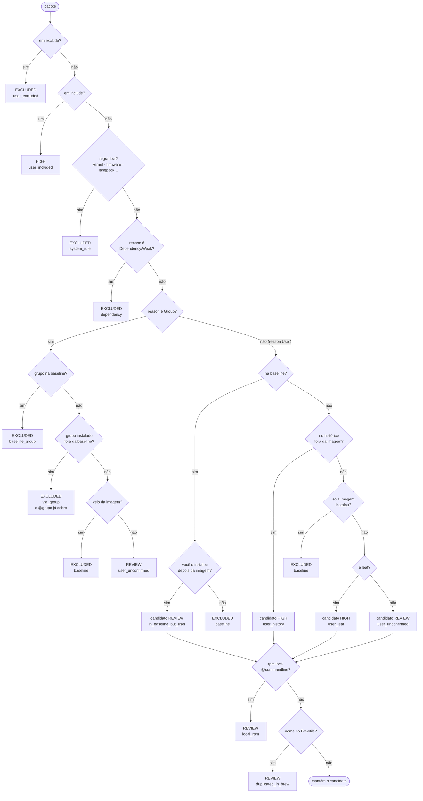
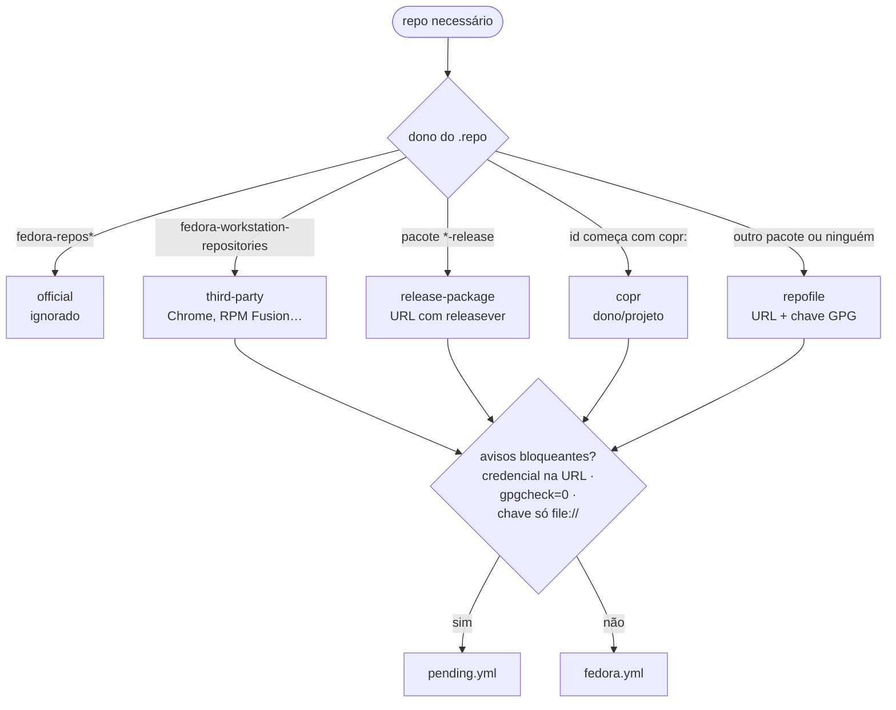
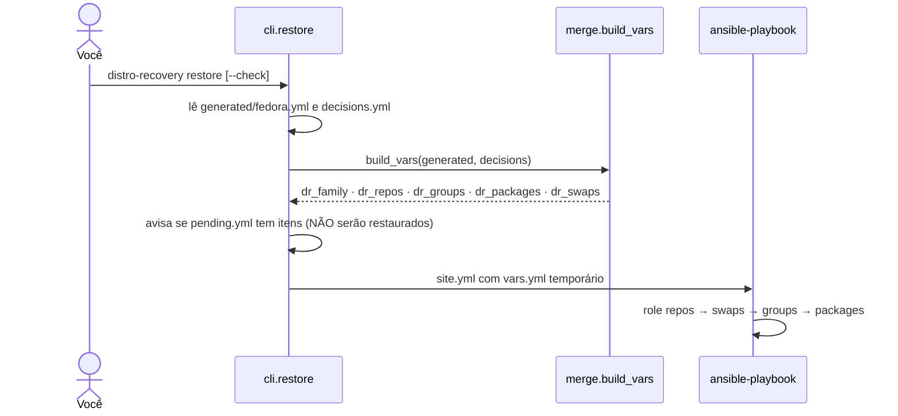
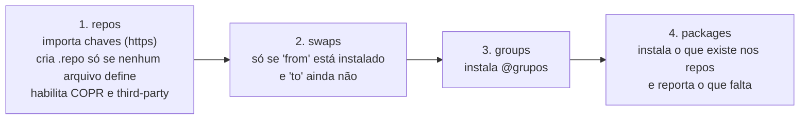

# Como o distro-recovery funciona

Guia para ler e entender o código. Os diagramas usam [Mermaid](https://mermaid.js.org/) (o
GitHub e a maioria dos editores renderizam). Para o uso do dia a dia, veja o `README.md`.

## 1. A ideia em uma frase

Duas metades que conversam por arquivos YAML:

- **backup** (Python): olha o sistema, decide o que foi *escolha sua* e grava YAML.
- **restore** (Ansible): lê esse YAML, mais as suas decisões, e recria repositórios, grupos e
  pacotes.



Regra de ouro: **gerado ≠ decidido**. O `backup` reescreve `generated/` inteiro, mas *nunca*
toca no `decisions.yml`. O único comando que cria esse arquivo é o `init` (e só se ele não
existir).

## 2. Mapa dos módulos

```
src/distro_recovery/
├── cli.py               # comandos (typer): liga todas as peças; faz o I/O
├── model.py             # tipos de dados (dataclasses/enums), sem lógica de I/O
├── classify.py          # PURO: tabela de decisão "este pacote entra no backup?"
├── merge.py             # lê decisions.yml e calcula as variáveis do Ansible
├── render.py            # grava YAML de forma determinística
├── brewfile.py          # lê ~/.Brewfile (detecta nomes duplicados com o brew)
├── keys.py              # baixa chaves GPG (https) e lê fingerprints
├── repokeys.py          # endereços de chaves GPG: tabela conhecida + conferência
├── decisions_template.py# texto do decisions.yml criado pelo `init`
├── backends/
│   ├── base.py          # Protocol Backend + runners (real, fixtures) + trava somente-leitura
│   └── dnf5.py          # implementação para Fedora/DNF5
└── ansible/             # site.yml + roles (repos, swaps, groups, packages)
```

Dependências entre eles (seta = "usa"):



Em verde: módulos sem acesso ao sistema (só recebem dados e devolvem dados), por isso são
fáceis de testar. Todo contato com o sistema passa por **um único ponto**: o *runner*.

## 3. O runner: por que os testes não tocam no seu sistema

O backend nunca chama `subprocess` diretamente. Ele recebe um *runner* (uma função
`argv -> CmdResult`). Em produção é o `SubprocessRunner`; nos testes e em
`backup --from-fixtures` é o `FixtureRunner`, que responde com arquivos gravados.

```mermaid
flowchart LR
    DNF[Dnf5Backend] --> R{Runner}
    R -- produção --> SP[SubprocessRunner]
    R -- testes / --from-fixtures --> FX[FixtureRunner]
    SP --> WL{lista branca<br/>somente leitura?}
    WL -- sim --> OS[(dnf5 · rpm · ls · cat)]
    WL -- não --> ERR[ReadOnlyViolation]
    FX --> MAN[tests/fixtures/dnf5<br/>manifest.yml + saídas]
```

`SubprocessRunner` só aceita `ls`, `cat`, `rpmkeys --list`, `rpm -q…` e os subcomandos de
consulta do `dnf5` (`repoquery`, `leaves`, `group|environment list|info`, `history list|info`).
Qualquer outra coisa levanta `ReadOnlyViolation`. Também nunca usa shell nem stdin.

## 4. Fluxo do `backup`



Passo a passo no código (`cli.py`, função `backup`):

1. **Coleta** (somente leitura): pacotes instalados, baseline, grupos, histórico, leaves.
2. **Classificação**: cada pacote vira `HIGH`, `REVIEW` ou `EXCLUDED` (seção 5).
3. **Repositórios**: descobre quais repos os pacotes usam e monta uma receita para cada um
   (seção 6).
4. **Gravação**: reescreve `generated/` por inteiro.
5. **Relatório** e código de saída.

## 5. A classificação: "este pacote foi escolha minha?"

O DNF registra um *motivo* (`reason`) para cada pacote: `User` (você pediu), `Group` (veio de
um grupo), `Dependency` / `Weak Dependency` (veio de carona). O classificador cruza isso com
o histórico, a baseline e as suas decisões. A primeira regra que casar vence
(`classify._decide`):



Destino de cada resultado:

| Resultado | Vai para | Significado |
|---|---|---|
| `HIGH` | `generated/fedora.yml` | será instalado no restore |
| `REVIEW` | `generated/pending.yml` | precisa da sua decisão (veja `reason_code`) |
| `EXCLUDED` | só o log (`--verbose`) | sistema, dependência ou coberto por grupo |

Conceitos usados:

- **Baseline**: o que a instalação "de fábrica" do Fedora já traz (grupos obrigatórios e padrão
  do ambiente instalado + `kernel*`, firmwares etc.). Calculada em `Dnf5Backend.baseline()`.
- **Transações de imagem**: as primeiras transações do histórico podem ser a montagem da imagem
  do Fedora (todos os pacotes vêm de um repo cujo id é um hash de 32 hex). Elas *não* contam
  como ação sua.
- **Leaf**: pacote de que nenhum outro depende. Um `User` que é leaf, fora do histórico, é
  provavelmente escolha sua.

### Quando um pacote cai em `pending.yml` (como `bat`, `eza`, `rust`)

Se o nome também está no `~/.Brewfile`, o resultado é `REVIEW / duplicated_in_brew`: a
ferramenta não sabe se você quer instalar via DNF ou só via brew. A saída é decidir no
`decisions.yml` (`exclude` para ficar só no brew, `include` para instalar via DNF).

## 6. Repositórios

Necessários = `from_repo` de todos os pacotes instalados, menos os oficiais e a mídia de
instalação (`@System`, `@commandline`, hash de 32 hex). Para cada um, `Dnf5Backend.repos()` lê
os arquivos `/etc/yum.repos.d/*.repo`, descobre o **dono** de cada arquivo (`rpm -qf`) e o dono
define o tipo (`_spec`):



Detalhes importantes:

- URLs são normalizadas: a versão fixa vira `$releasever` e a arquitetura `$basearch`.
- **Chaves GPG**: guardamos o *endereço* oficial, nunca a chave nem um fingerprint fixo; o
  restore baixa e importa. Se o `.repo` perdeu o endereço, `repokeys.py` consulta a tabela
  `KNOWN_GPGKEYS` ou o override `repos.gpgkey` do `decisions.yml`.
- Se o mesmo id está em dois arquivos `.repo`, vale o que tem chave remota (aviso
  `duplicate_repo_id`, só informativo).

## 7. Os arquivos de dados

```
~/.config/distro-recovery/
├── decisions.yml          # VOCÊ edita (criado por `init`)
├── generated/             # a FERRAMENTA escreve, a cada backup
│   ├── fedora.yml         #   family, repos, groups, packages
│   ├── pending.yml        #   packages (+reason_code), repos, missing_repos
│   └── meta.yml           #   versão, data/hora e contagens
└── ansible/               # só com `backup --ansible`: playbook + vars.yml
```

`decisions.yml` (todas as chaves são opcionais):

| Chave | Efeito |
|---|---|
| `include` | força um pacote a entrar no restore |
| `exclude` | impede um pacote de ser restaurado (vence `include`; estar nos dois = erro) |
| `repos.exclude` | ignora repositórios por id |
| `repos.gpgkey` | informa o endereço (https) da chave de um repo |
| `swaps` | trocas `from -> to` (`dnf5 swap --allowerasing`), a única forma de remover algo |
| `renames` | lido e validado, mas ainda não usado no restore |

Determinismo: strings sempre entre aspas, listas ordenadas, ordem fixa de chaves. Duas execuções
sem mudança no sistema geram arquivos idênticos (exceto `meta.yml`, que tem data).

## 8. Fluxo do `restore`



Precedência ao montar as variáveis (`merge.build_vars`):
`pacotes = (generated ∪ include) − exclude`.

Roles do Ansible, em ordem (`src/distro_recovery/ansible/`):



O role `packages` primeiro pergunta ao DNF quais nomes existem (`repoquery --available`),
instala a interseção e *relata* os ausentes (com possíveis substitutos), sem falhar.

Garantias de segurança do restore (cobertas por testes estáticos): nunca remove, nunca faz
downgrade, nunca desabilita GPG; `--allowerasing` só aparece no role `swaps`.

## 9. Comandos e códigos de saída

| Comando | O que faz | Saída |
|---|---|---|
| `backup [--ansible] [--dir] [--from-fixtures] [--brewfile] [--verify-keys] [--verbose]` | inventário | 0 ok · 2 há pendências · 1 erro |
| `init [--dir]` | cria `decisions.yml` comentado (nunca sobrescreve) | 0 |
| `restore [--check] [--no-ask-become-pass]` | executa o playbook | 0 ok · 1 erro |
| `review`, `diff`, `doctor` | **ainda não implementados** (dão erro) | 1 |

`--from-fixtures` roda o backup inteiro sobre saídas gravadas, sem tocar no sistema, e exige
`--dir` explícito.

## 10. Testes e ferramentas de apoio

- `tests/` — `pytest`. Fixtures reais em `tests/fixtures/dnf5/` (saídas gravadas de
  comandos). Há testes por `reason_code`, de determinismo do YAML, estáticos do Ansible e da
  CLI.
- `scripts/vm-test.sh` — restore de ponta a ponta numa VM descartável (QEMU). Ver `VM_TEST.md`.
- `yadm-autobackup/` — script e unidades systemd que automatizam o backup dos dotfiles (yadm)
  junto com o `brew bundle dump` e o `distro-recovery backup`.
- `docs/pendencias.md` — decisões ainda abertas.

## 11. Glossário rápido

| Termo | Significado |
|---|---|
| **DNF5** | gerenciador de pacotes do Fedora |
| **reason** | por que o DNF instalou o pacote: User, Group, Dependency, Weak Dependency |
| **leaf** | pacote que nenhum outro pacote exige |
| **baseline** | pacotes que já vêm com a instalação padrão |
| **COPR** | repositórios comunitários do Fedora (`dono/projeto`) |
| **swap** | troca de um pacote por outro numa transação |
| **fixture** | saída de comando gravada, usada nos testes no lugar do sistema real |
| **runner** | função que executa comandos; injetada para poder trocar por fixtures |
| **GPG / gpgkey** | assinatura que garante a origem dos pacotes de um repositório |

## 12. Como estender para outra distribuição

Implemente o `Protocol Backend` (`backends/base.py`): `detect`, `installed`,
`installed_groups`, `baseline`, `history_user_installs`, `leaves`, `repos`. O classificador, o
render e o merge não mudam, porque só enxergam os tipos de `model.py`. Falta ainda um role
Ansible equivalente e a escolha do backend na CLI (hoje fixa em `Dnf5Backend`).
